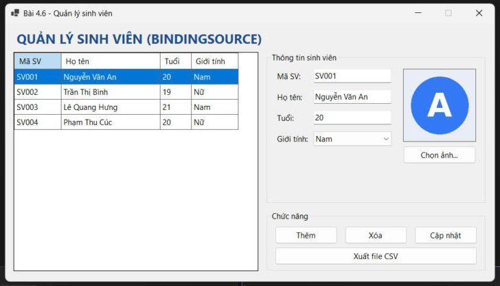
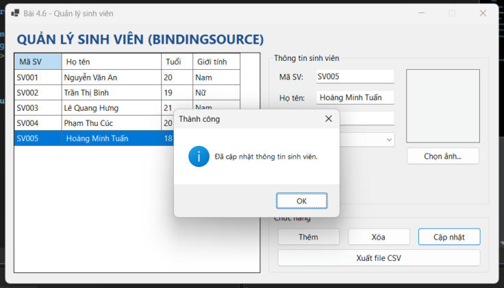
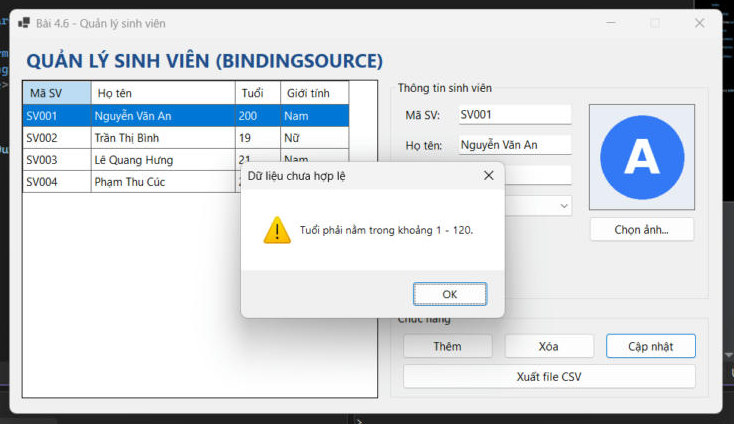
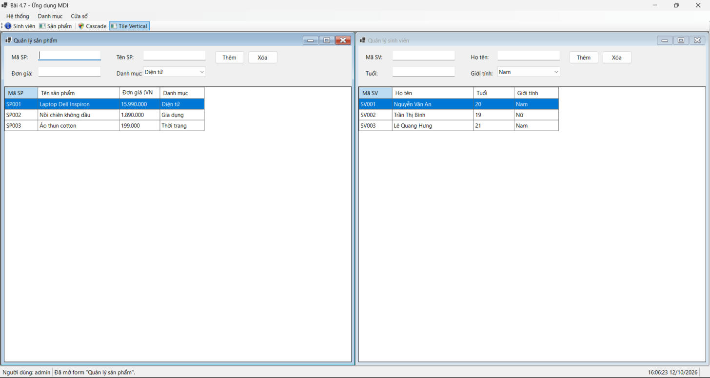
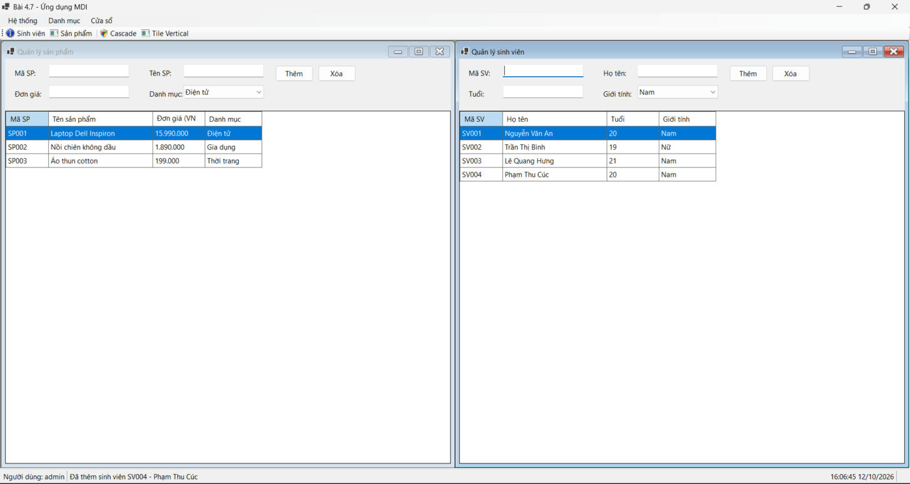
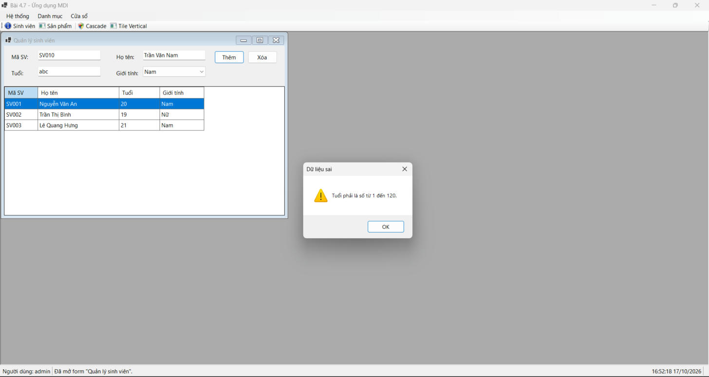
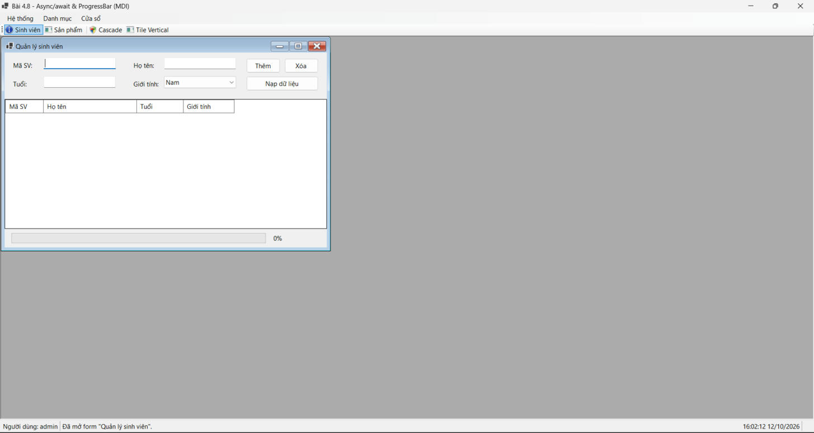
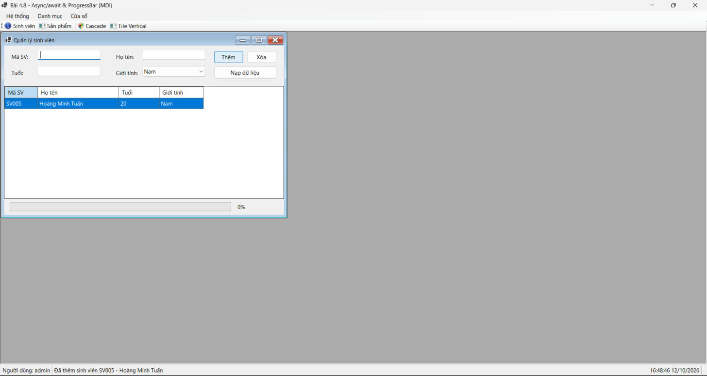
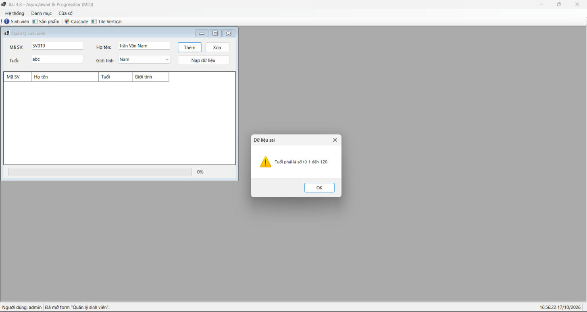

# BÁO CÁO BÀI TẬP / ĐỒ ÁN

## THÔNG TIN SINH VIÊN
- **Họ và tên:** Lê Quang Hưng
- **Mã số sinh viên:** 24810320237
- **Lớp:** d19qtanm1
- **Tên môn học:** Lập trình .NET (C# / Windows Forms)
- **Tên bài tập:** Bài 4.6, 4.7, 4.8

## CẤU TRÚC DỰ ÁN

Mỗi bài nằm trong thư mục riêng, có file solution riêng (ví dụ `4.6/4.6.slnx`), project Windows Forms (.NET 10):

| Thư mục / Solution | Nội dung |
|---|---|
| `4.6/4.6.slnx` | Quản lý sinh viên: `BindingSource`, `DataBindings`, `OpenFileDialog` (Avatar), `SaveFileDialog` (xuất CSV) |
| `4.7/4.7.slnx` | Khung ứng dụng MDI: `MenuStrip`, `ToolStrip`, `StatusStrip`, `ContextMenuStrip`, form con mở một lần |
| `4.8/4.8.slnx` | `async/await`, `Task.Run`, `IProgress<int>`, `ProgressBar` trên MDI |

---

## KẾT QUẢ THỰC HÀNH

## Bài 4.6: Quản lý dữ liệu với BindingSource và xử lý file (Avatar / CSV)

### 1. Ảnh màn hình Giao diện chính (chưa nhập dữ liệu)

*Vừa chạy chương trình: danh sách sinh viên mẫu trên `DataGridView`, chọn dòng nào thì các ô nhập và ảnh Avatar tự đổi theo dòng đó.*

### 2. Ảnh màn hình Nhập dữ liệu thành công

*Nhấn Thêm, nhập Họ tên "Hoàng Minh Tuấn" rồi nhấn Cập nhật: dòng SV005 xuất hiện trong lưới, hiện thông báo cập nhật thành công.*

### 3. Ảnh màn hình Nhập dữ liệu báo lỗi (Validation)

*Nhập Tuổi = 200 (sai) rồi nhấn Cập nhật: hiện cảnh báo "Tuổi phải nằm trong khoảng 1 - 120", không lưu dữ liệu sai.*

---

## Bài 4.7: Khung ứng dụng MDI và quản lý đa cửa sổ

### 1. Ảnh màn hình Giao diện chính (chưa nhập dữ liệu)

*Form MDI cha có MenuStrip (Hệ thống, Danh mục, Cửa sổ), ToolStrip lối tắt, StatusStrip (người dùng, thông báo, giờ hệ thống); mở 2 form con và sắp xếp Tile Vertical, các ô nhập còn trống.*

### 2. Ảnh màn hình Nhập dữ liệu thành công

*Thêm sinh viên SV004 ở form con: dòng mới xuất hiện trong lưới, StatusStrip của form cha hiện thông báo "Đã thêm sinh viên SV004 - Phạm Thu Cúc".*

### 3. Ảnh màn hình Nhập dữ liệu báo lỗi (Validation)

*Nhập Mã SV, Họ tên nhưng Tuổi = "abc" (sai) rồi nhấn Thêm ở form con: hiện cảnh báo "Dữ liệu sai - Tuổi phải là số từ 1 đến 120", không thêm vào danh sách.*

---

## Bài 4.8: Lập trình bất đồng bộ (async/await) và ProgressBar

### 1. Ảnh màn hình Giao diện chính (chưa nhập dữ liệu)

*Form MDI cha, form con Quản lý sinh viên có nút Nạp dữ liệu, thanh tiến trình 0%, các ô nhập còn trống.*

### 2. Ảnh màn hình Nhập dữ liệu thành công

*Nhập Mã SV, Họ tên, Tuổi rồi nhấn Thêm: sinh viên SV005 xuất hiện trong lưới, StatusStrip của form cha hiện thông báo thêm thành công.*

### 3. Ảnh màn hình Nhập dữ liệu báo lỗi (Validation)

*Nhập Mã SV, Họ tên nhưng Tuổi = "abc" (sai) rồi nhấn Thêm: hiện cảnh báo "Dữ liệu sai - Tuổi phải là số từ 1 đến 120", không thêm vào danh sách.*
